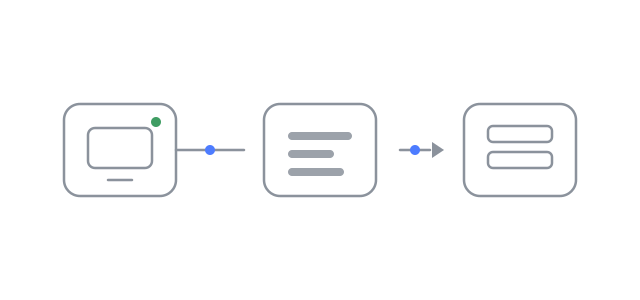

# Claw-Mesh

English | [简体中文](README.zh-CN.md)

**GitHub:** [AlanTaoEx/dsh-claw-mesh](https://github.com/AlanTaoEx/dsh-claw-mesh)

LAN device mesh for **DeepSeek Harness**. Every DSH instance that signs in with the same account on
your network joins one mesh: devices discover each other, each device grants control on its own
terms, SSH-only machines stay behind the node that registers them, and **any chat** can hand work to
an agent running on another device.



## Features

| | |
| --- | --- |
| **Discovery** | Devices announce themselves over UDP `46801`. Only peers with the same account fingerprint are visible; anything else is ignored on arrival, endpoints included. The broadcast can be switched off per device. |
| **Per-device control** | Each peer has its own *allow this device to control this machine* switch, off by default, grantable only by a human. The reverse direction is shown separately and must be granted on the other machine. |
| **Remote dispatch** | A short device inventory is injected into every session, so you can ask in plain language. The agent calls `mesh_dispatch`; the target runs `dsh --profile headless` locally and streams the result back into your conversation. |
| **SSH endpoints** | Machines that cannot run DSH (Linux servers, NAS, SBCs) are registered as endpoints. Only the registering node opens SSH; other nodes ask it, and only for endpoints that are shared. |
| **Status** | Online dots for peers, a 60-second SSH probe per owned endpoint, and a hardware profile (system, CPU, memory, GPU, free disk) on every device row. |

## Requirements

- DeepSeek Harness Desktop 0.2.x, signed in on every device.
- The same DeepSeek account on both sides — different accounts never pair.
- IP reachability. The plugin ships no tunnel; Tailscale, ZeroTier, or EasyTier are fine as a base.

## Install

```bash
# macOS
ELECTRON_RUN_AS_NODE=1 "/Applications/DeepSeek Harness.app/Contents/MacOS/DeepSeek Harness" \
  "/Applications/DeepSeek Harness.app/Contents/Resources/app.asar/dsh/node_modules/@deepseek-ai/dsh/lib/bin.js" \
  plugin --profile desktop add link:/path/to/dsh-claw-mesh
```

```powershell
# Windows
$env:ELECTRON_RUN_AS_NODE = "1"
& "$env:LOCALAPPDATA\Programs\DeepSeek Harness\DeepSeek Harness.exe" `
  "$env:LOCALAPPDATA\Programs\DeepSeek Harness\resources\app.asar\dsh\node_modules\@deepseek-ai\dsh\lib\bin.js" `
  plugin --profile desktop add link:C:\path\to\dsh-claw-mesh
```

Restart DSH, or toggle the bundle once under **Plugins**. The sidebar then shows
**设备连接 / Claw-Mesh**.

## Use it

1. Open **设备连接**. Your own device comes first, peers second, SSH endpoints third.
2. Open a peer and switch on **允许该设备控制本机** to let it send work here.
3. Do the same on the other machine if you want to send work the other way — control is not
   symmetric and never granted by an agent.
4. Ask in any chat:

   > run `git status` on Build Server and paste the output

   The agent picks the device with `mesh_list_devices` and calls `mesh_dispatch`.
5. For a Linux box: **外部设备（SSH） → 添加**, fill in host, user, key path (or password), then
   **测试连接**. Enable **共享** when other authorized devices should be able to use it.

## Tools exposed to the agent

| Tool | Purpose |
| --- | --- |
| `mesh_list_devices` | Peers, endpoints, hardware profile, online state, latency. |
| `mesh_dispatch` | Run a prompt on a peer or on `self`; can pick the node by `requires` (`os`, `gpu`, `minCores`, `minMemGb`, `tag`). |
| `mesh_job_status` | Poll a dispatch with `jobId` + `jobDeviceId`. |
| `mesh_ssh_run` | Run one shell command on an SSH endpoint. |
| `mesh_add_endpoint` | Register an endpoint with a key or a password, optionally shared. |

## Ports

| Port | Plane | Reachability |
| --- | --- | --- |
| UDP `46801` | discovery broadcast | LAN |
| TCP `46800` | peer control plane (`/mesh/info`, `/mesh/pair`, `/mesh/control`) | LAN, HMAC-signed per pair |
| TCP `46810` | local UI plane (`/ui/*`) | loopback only |

Ports shift upward when busy. On Windows allow the app on private networks, or open `46800/tcp`
and `46801/udp`.

## Remote workspaces

Authorized DSH workspaces and session titles appear in a collapsible section at the bottom of the sidebar. The section refreshes on demand and every 15 seconds; the whole section or individual device groups can be folded.

Selecting an existing session opens its real remote conversation: recent user/assistant history is loaded, and you can send prompts or cancel the running turn. Selecting an empty workspace creates a new DSH session in that remote directory. Messages refresh every two seconds; files and session history remain on the target. Workspace metadata is requested only from devices that granted control and is never included in UDP broadcasts.

## Security model

- Pairing exchanges a random 32-byte key; every control request is HMAC-SHA256 signed over
  `deviceId\nts\nbody` with a two-minute window.
- Authorization is per device and per direction, and only a human can grant it.
- SSH credentials stay in the registering node's state file (`~/.dsh/claw-mesh/state.json`). They
  are never broadcast, never sent to peers, and never passed on a command line.
- Endpoints are private by default; a remote node sees only the endpoints you explicitly share.
- The UI plane binds to loopback, so other machines cannot drive your panel.

## Documentation

- [docs/GUIDE.md](docs/GUIDE.md) — the full manual (Chinese): console layout, permission model,
  in-session dispatch, SSH endpoints and authentication, hardware profile, state and diagnostics.

## Development

```bash
npm run check                # manifest, locales, detail document, icon, syntax
npm test                     # two-node discovery, trust, sharing and job regression tests
npm run pack                 # build version/<name>-<version>.zip from tracked files
node tools/second-node.mjs   # a second node on one machine, for LAN tests
```

`version/` holds local release archives and is git-ignored — builds stay out of the repository.

## License

MIT
