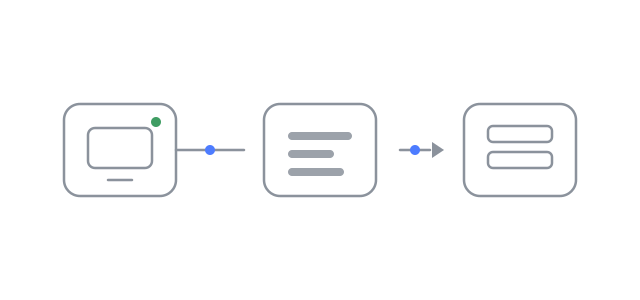

# Claw-Mesh

**GitHub 仓库：** [AlanTaoEx/dsh-claw-mesh](https://github.com/AlanTaoEx/dsh-claw-mesh)

**面向 DeepSeek Harness 的局域网 Agent 设备网。**

Claw-Mesh 让同一局域网中的 DSH 实例自动发现彼此。经过逐设备、逐方向授权后，任意会话都可以把任务交给另一台设备上的 Agent 执行，并持续查询任务状态和最终结果。无法安装 DSH 的 Linux 服务器、NAS 或树莓派，也可以作为 SSH 外部设备接入。



## 核心能力

- **自动发现**：通过 UDP 广播发现在线设备、账号指纹、硬件画像和共享 SSH 端点。
- **Agent 互相委托**：目标任务在对端通过 `dsh --profile headless` 启动一次性 Agent，不是简单转发 shell。
- **人工授权**：控制权限按设备、按方向授予，默认关闭；Agent 不能自行放开权限。
- **权限上限**：每个对端可单独设置最高权限，默认 `workspace-write`。
- **可靠调度**：控制协议 v1 提供 `requestId` 幂等、签名重放保护、结构化错误和任务状态查询。
- **按能力选机**：可按操作系统、GPU、CPU 核数、内存和标签选择目标设备。
- **SSH 外部设备**：凭据只保存在注册机，其他节点只能使用明确共享的端点。
- **原生控制台**：设备、授权、硬件画像、端点和设置均在 DSH 侧边栏中完成。

## 工作原理

```text
当前会话中的 Agent
        │ mesh_dispatch
        ▼
本机 Claw-Mesh Host
        │ HTTP + HMAC + requestId
        ▼
目标设备 Claw-Mesh Host
        │ dsh --profile headless --json -
        ▼
目标设备上的一次性 Agent
        │ jobId / 状态 / 事件 / finalText
        ▼
当前会话获得任务结果
```

插件包含两个部分：

| 部分 | 入口 | 职责 |
| --- | --- | --- |
| Host | `index.js` | Harness 工具、系统提示、节点发现、配对、控制协议、任务和 SSH |
| Client | `client.js` | “设备连接”侧边栏、授权、端点管理和设置 |

UI 与 Agent 复用同一组本机服务方法，远程任务和本机任务也复用同一套 JobManager。

## 两类设备

| 类型 | 运行方式 | 使用条件 |
| --- | --- | --- |
| **DSH 节点** | 对端启动 headless DSH Agent | 安装 DSH、登录同一 DeepSeek 账号、IP 可达并完成授权 |
| **SSH 外部设备** | 注册机通过 SSH 执行命令，或由注册机 Agent 操作 | 注册机能够 SSH 登录；跨节点使用时必须显式共享 |

SSH 外部设备不是对等 DSH 节点。它始终归属于注册它的那台 DSH 设备，其他节点只与注册机通信。

## 前置条件

- DeepSeek Harness Desktop `0.2.x`；
- DSH 节点登录同一个 DeepSeek 账号；
- 节点之间 IP 可达，并允许 UDP 广播；
- 目标设备可以使用与其 DSH 版本匹配的 `dsh --json`；
- 开发测试需要 Node.js `22` 或更高版本。

项目仅面向局域网或已经互通的私有网络，不自带公网隧道、NAT 穿透或注册中心。

## 安装

在两台需要互联的 DSH 设备上分别安装同一个插件版本。

### macOS

```bash
ELECTRON_RUN_AS_NODE=1 "/Applications/DeepSeek Harness.app/Contents/MacOS/DeepSeek Harness" \
  "/Applications/DeepSeek Harness.app/Contents/Resources/app.asar/dsh/node_modules/@deepseek-ai/dsh/lib/bin.js" \
  plugin --profile desktop add link:/path/to/dsh-claw-mesh
```

### Windows PowerShell

```powershell
$env:ELECTRON_RUN_AS_NODE = "1"
& "$env:LOCALAPPDATA\Programs\DeepSeek Harness\DeepSeek Harness.exe" `
  "$env:LOCALAPPDATA\Programs\DeepSeek Harness\resources\app.asar\dsh\node_modules\@deepseek-ai\dsh\lib\bin.js" `
  plugin --profile desktop add link:C:\path\to\dsh-claw-mesh
```

安装后重启 DSH，或者在“插件”页面将 Claw-Mesh 关闭再开启。侧边栏会出现 **设备连接**。

## 快速上手

### 1. 确认设备已经发现

打开 **设备连接**：

- 本机显示在最上方；
- 同账号在线设备显示在“在线设备”中；
- 不显示其他账号的设备，它们的广播会被直接丢弃，SSH 设备也一样；
- SSH 外部设备显示在独立分区。

如果设备没有出现，先检查局域网广播、防火墙和账号登录状态。

### 2. 配对并授权

打开目标设备详情：

1. 完成配对；
2. 在**被控制的那台设备**上打开“允许该设备控制本机”；
3. 根据需要设置“允许的最高权限”。

例如，希望 A 调度 B，必须在 **B** 上允许 A 控制 B。反向控制需要在 A 上单独授权。

### 3. 在任意会话中派发任务

可以直接说：

> 让 Build Server 跑一下 `git status`，把结果贴回来

> 挑一台有 GPU 的设备检查显卡型号

> 在本地把测试跑一遍

Agent 会先调用 `mesh_list_devices` 获取实时设备清单，再调用 `mesh_dispatch`。长任务会返回 `jobId`，后续通过 `mesh_job_status` 查询。

## Agent 工具

| 工具 | 用途 |
| --- | --- |
| `mesh_list_devices` | 获取 DSH 节点、共享 SSH 端点、在线状态、授权状态和硬件画像 |
| `mesh_dispatch` | 在指定设备、`self` 或符合能力条件的设备上启动 Agent 任务 |
| `mesh_job_status` | 使用 `jobId` 和 `jobDeviceId` 查询状态、事件及最终回答 |
| `mesh_ssh_run` | 在 SSH 外部设备上执行一条命令并返回退出码和输出 |
| `mesh_add_endpoint` | 在当前节点注册 SSH 外部设备，支持密钥或密码认证 |

### `mesh_dispatch` 主要参数

| 参数 | 说明 |
| --- | --- |
| `target` | DSH `deviceId`、SSH `endpointId` 或 `self` |
| `prompt` | 目标 Agent 要执行的自然语言任务 |
| `requestId` | 可选幂等键，8–128 个字符；相同任务重试不会重复启动 |
| `cwd` | 可选目标工作目录 |
| `permissionMode` | `read-only`、`workspace-write`、`danger-full-access`，不能超过目标端上限 |
| `requires` | 可选能力过滤：`os`、`gpu`、`minCores`、`minMemGb`、`tag` |
| `waitMs` | 最长同步等待时间；到期后任务继续运行并返回 `jobId` |

## 远端工作区

已授权 DSH 的工作区和会话标题会显示在侧栏底部的可折叠区域。数据按需获取并每 15 秒刷新，既可以折叠整个区域，也可以单独折叠某台设备。

点击已有会话会打开真实的远端会话：读取最近的用户和 Agent 消息，并可直接发送 prompt 或停止当前回合。点击空白工作区则会在对应远端目录创建正式 DSH 会话。消息每两秒刷新，文件和会话历史始终保留在目标设备。工作区信息只从已授权设备按需读取，不通过 UDP 广播。

## 权限与安全模型

### 配对和请求认证

- 配对时交换随机 32 字节密钥；
- 控制请求使用 HMAC-SHA256 签名，签名内容为 `deviceId\nts\nbody`；
- 时间戳有效期为两分钟，非法数字和过期时间戳都会被拒绝；
- 相同签名在时间窗口内重放会被拒绝。

账号指纹用于局域网发现分组，**不等同于设备所有者身份证书**。是否允许控制仍以本机人工配对和授权为准。

### 权限边界

- 授权逐设备、逐方向，默认关闭；
- 每个对端的最高权限独立设置，默认 `workspace-write`；
- 调用方可以请求更低权限，不能请求更高权限；
- 远端不能覆盖目标节点的审批策略；
- 授权和最高权限只能通过本机 UI 修改，Agent 工具不提供授权接口。

### 本地界面和凭据

- UI 服务只监听 `127.0.0.1`，并校验 `Origin`；
- 配对密钥和 SSH 凭据只保存在注册机的 `state.json`；
- 状态目录和文件分别限制为 `0700`、`0600`（支持 POSIX 权限的平台）；
- 状态文件通过临时文件和原子重命名写入；
- 私有 SSH 端点不会广播，远端只能看到明确共享的端点；
- SSH 密码通过 `SSH_ASKPASS` 使用，不出现在命令行参数中。

## 控制协议 v1

请求示例：

```json
{
  "v": 1,
  "requestId": "8f5d95f0-8d37-4f91-9f6f-example",
  "action": "dispatch",
  "params": {
    "prompt": "git status",
    "permissionMode": "read-only"
  }
}
```

成功响应：

```json
{
  "v": 1,
  "requestId": "8f5d95f0-8d37-4f91-9f6f-example",
  "ok": true,
  "result": {
    "jobId": "目标节点任务 ID",
    "target": "Build Server"
  }
}
```

旧格式请求仍然可用，并保持旧格式响应，便于全网滚动升级。节点通过 `/mesh/info` 的 `protocols` 和 `features` 声明能力。

### 幂等语义

- `dispatch`、`endpoint.task`：相同 ID 和参数返回原 `jobId`；
- `endpoint.run`：相同 ID 和参数返回缓存输出；
- 仍在执行时返回 `duplicate-in-progress`；
- 相同 ID 对应不同内容时返回 `request-id-conflict`；
- 本地 `self` 与远程调用遵循相同规则；
- 节点重启后，未完成的请求返回 `request-interrupted`；
- 近期记录最长保留 24 小时，已完成记录最多保留 200 条，执行中的记录不会被清理。

幂等可以抑制重复调用，但不能对所有外部副作用承诺严格的 exactly-once。节点在“操作已执行、结果尚未落库”之间崩溃时，调用方仍应先确认实际状态，再决定是否使用新 ID 重试。

## SSH 外部设备

在 **外部设备（SSH） → 添加** 中填写主机、端口、用户和认证信息。

支持两种使用方式：

- **远程命令**：通过 `mesh_ssh_run` 执行一条确定命令；
- **Agent 任务**：通过 `mesh_dispatch` 让注册机上的 Agent 多步操作该设备。

端点默认私有。开启“共享”后，只有已获授权控制注册机的节点才能转发命令或任务，SSH 连接仍由注册机发起。

不支持交互式二次验证或 OTP，优先推荐使用受限 SSH 密钥。

## 网络端口

| 默认端口 | 网络面 | 用途 |
| --- | --- | --- |
| UDP `46801` | 发现面 | 广播设备、账号指纹、硬件画像和共享端点 |
| TCP `46800` | 控制面 | `/mesh/info`、`/mesh/pair`、`/mesh/control` |
| TCP `46810` | UI 面 | 仅回环访问的 `/ui/*` |

端口冲突时自动向上顺延。Windows 防火墙应允许应用访问专用网络，或放行相应 TCP/UDP 端口。

## 任务与状态

- 单次任务默认超时 30 分钟；
- 超时任务进入 `timed_out`，先尝试 `SIGTERM`，5 秒后仍未退出则使用 `SIGKILL`；
- 其他状态包括 `running`、`completed`、`failed`、`cancelled`；
- 最终回答与事件预览分开保存，避免结果被预览长度截断；
- 单行超过 1 MiB 的输出会被丢弃并记录 `output-truncated`；
- 最近任务摘要会持久化，但插件重启不会恢复已经终止的 headless 进程。

## 排障

| 现象 | 优先检查 |
| --- | --- |
| 看不到其他设备 | 是否同一账号、IP 是否可达、AP 是否隔离广播、UDP `46801` 是否被拦截 |
| 已发现但无法调度 | 是否已配对、目标设备是否已授权本机、方向是否正确 |
| 权限被拒绝 | 请求权限是否超过目标端为该对端设置的最高权限 |
| 提示找不到 dsh CLI | 确认 `dsh` 已安装并加入 `PATH`，且目标版本支持 `--json` |
| headless 鉴权失败 | 检查目标设备登录状态和 headless 凭据配置 |
| 面板无法连接 | 查看 `~/.dsh/claw-mesh/ui.log` 和本机 UI 端口监听状态 |
| SSH 无法登录 | 先用注册机本机的 `ssh` 命令验证密钥、主机指纹和账号权限 |

主要运行文件：

```text
~/.dsh/claw-mesh/state.json
~/.dsh/claw-mesh/ui.log
~/.dsh/claw-mesh/headless-login.patch.yml
```

## 开发与测试

```bash
npm run check                # manifest、语言包、文档、图标和语法检查
npm test                     # 双节点集成与控制协议回归测试
npm run pack                 # 按 package.json 版本打包到 version/
node tools/second-node.mjs   # 在本机启动第二个联调节点
```

测试使用独立状态目录、动态端口和假的 dsh/SSH 可执行文件，不需要调用真实模型。覆盖发现、授权、共享、调度、幂等、重放、权限、超时和 SSH 行为。

`version/` 是本地发布产物目录，已被 Git 忽略。

## 文档

- [完整使用手册](docs/GUIDE.md)

## 已知限制

- 仅处理 IP 可达的局域网或私有网络，不自带公网组网能力；
- 企业 Wi-Fi 或 AP 隔离可能阻止 UDP 自动发现；
- 不保证崩溃场景下所有外部操作的严格 exactly-once；
- 不恢复插件重启前正在运行的 headless 进程；
- SSH 不支持交互式 OTP；
- 跨公网使用应先通过 Tailscale、ZeroTier 或 EasyTier 等工具建立可信网络底座。

## 许可证

MIT
